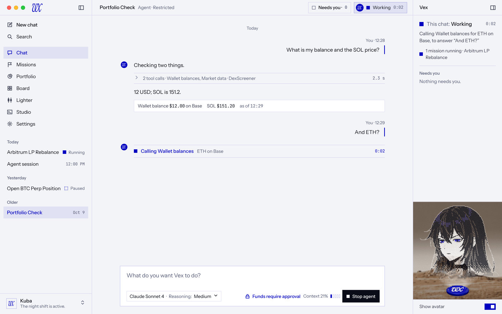
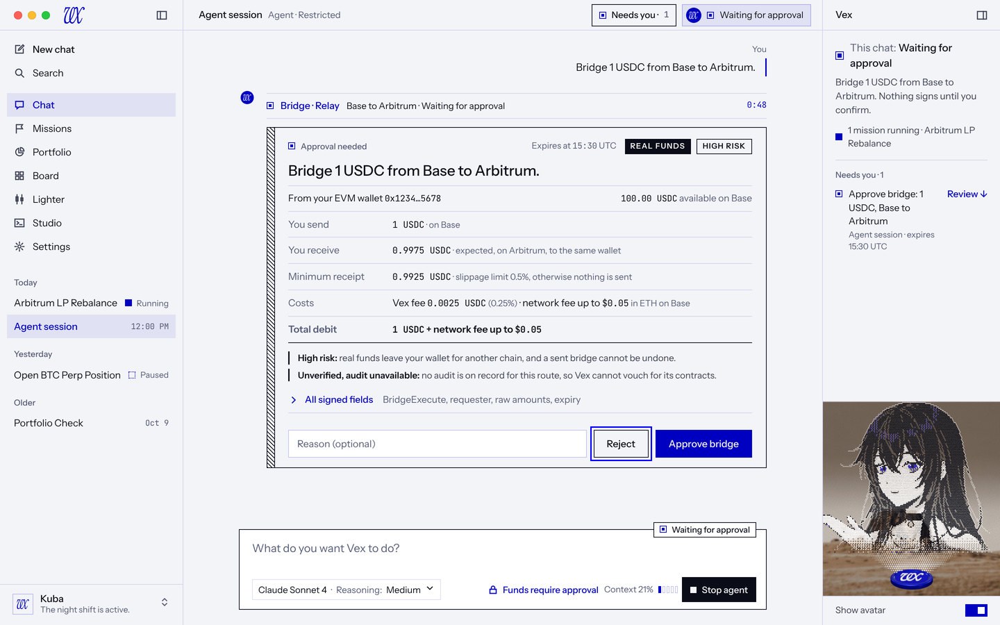
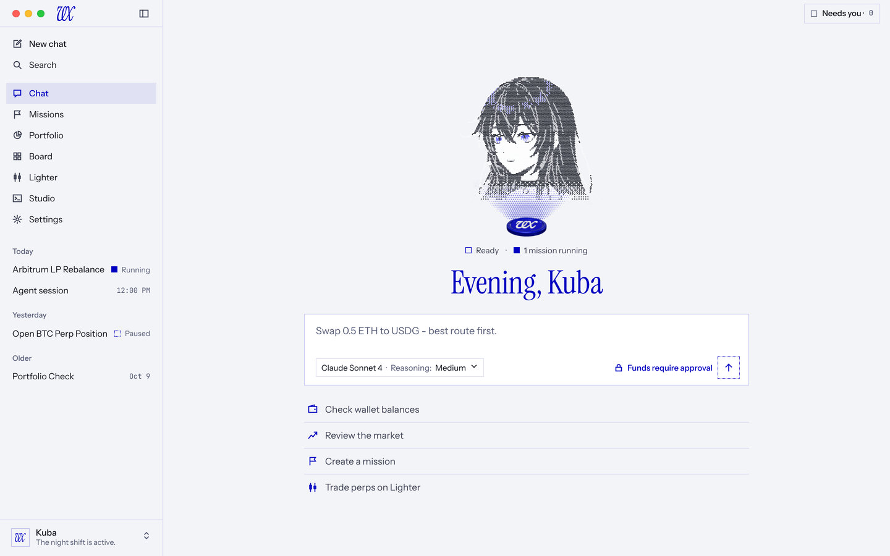

# R3 Minimal: the desktop design

VEX Desktop is a calm agent chat app in three columns: a left sidebar that says where you are, a centre that holds the conversation (or one page), and a right sidebar that is Vex, the K2 halftone hologram that rises from the vx token. The V10 language stays (paper, ink, one blue, Night Ledger at night, radius 0, no shadow, no glass); the open book, the gutter caption, the flock, the eagle and the pixel font are gone. Every state is a fill and a word. Money lives on its own pages, never in a side panel.

## Rules
- One blue `#0000C0`; `#A3ABFF` is its form on night paper and a 1px edge on night blue fills. No second accent.
- Radius 0. No shadow, blur, glass or gradient ramp. The only hatches and dot screens are the state swatches, the hatch bands on cards and callouts, and the hologram itself.
- Status is a fill plus a word, never a fill alone and never a colour. Failures are ink, never red.
- Green and red appear only on trading values (section 1.2); candles keep their own pair inside the chart.
- Instrument Sans for every word, JetBrains Mono for every figure, Instrument Serif at display sizes only. No pixel font.
- One paper per room: the left sidebar, the centre and the Vex sidebar sit on the same ground and are told apart by 1px rules.
- One blue fill per view (send, Approve, Confirm, Unlock).
- Where this document and `V10-SPREAD.md` disagree, this document wins. Where the three sheets of the design source disagree on a shared component, the core screens (welcome, chat, approval, portfolio) win; the work and system screens follow their own sheet for components only they use.

Every value in this document is the source of truth for the renderer. Code comments cite it as `docs/design/R3-MINIMAL.md section N`.

## Reference screens
Light (Celeris) and dark (Chronos), 1440 x 900 unless named. Images are under `r3/`.

| Screen | Light | Dark |
|---|---|---|
| d1 wake | [light](r3/d1-wake-light.jpg) | [dark](r3/d1-wake-dark.jpg) |
| d1 wake, unlock | [light](r3/d1-wake-unlock-light.jpg) | [dark](r3/d1-wake-unlock-dark.jpg) |
| d2 welcome | [light](r3/d2-welcome-light.jpg) | [dark](r3/d2-welcome-dark.jpg) |
| d3 chat, working | [light](r3/d3-chat-working-light.jpg) | [dark](r3/d3-chat-working-dark.jpg) |
| d4 chat, Vex hidden | [light](r3/d4-chat-sidebar-hidden-light.jpg) | [dark](r3/d4-chat-sidebar-hidden-dark.jpg) |
| d5 approval | [light](r3/d5-approval-light.jpg) | [dark](r3/d5-approval-dark.jpg) |
| d6 portfolio | [light](r3/d6-portfolio-light.jpg) | [dark](r3/d6-portfolio-dark.jpg) |
| Needs you page | [light](r3/d2x-approvals-light.jpg) | [dark](r3/d2x-approvals-dark.jpg) |
| Lighter desk | [light](r3/d2x-lighter-light.jpg) | [dark](r3/d2x-lighter-dark.jpg) |
| Studio workspace | [light](r3/d2x-studio-light.jpg) | [dark](r3/d2x-studio-dark.jpg) |
| Settings, Preferences | [light](r3/d3x-settings-preferences-light.jpg) | [dark](r3/d3x-settings-preferences-dark.jpg) |
| Wizard, step 1 | [light](r3/d3x-wizard-1-password-light.jpg) | [dark](r3/d3x-wizard-1-password-dark.jpg) |
| System states | [light](r3/d3x-states-light.jpg) | [dark](r3/d3x-states-dark.jpg) |
| Kit (three parts: tokens, type, states, buttons, sidebars, title bar; composer, conversation, approvals; the Vex sidebar in every state) | [1](r3/kit-light-1.jpg), [2](r3/kit-light-2.jpg), [3](r3/kit-light-3.jpg) | [1](r3/kit-dark-1.jpg), [2](r3/kit-dark-2.jpg), [3](r3/kit-dark-3.jpg) |

Differences between a render and this text, each decided here:
- d6 and the Lighter desk draw the Vex sidebar open; its default on table pages is hidden (section 2.3).
- The kit draws the armed second click of a high risk approval as "Click again to approve bridge"; the app keeps its own "Click again to confirm approve" (section 8.4).
- The renders show sample names, sample figures and a version number in the wake stamp; none of them is a value.

---

## 1. Tokens and type

### 1.1 Colour
Static values (the static tier in `tokens.css` already carries each of them except where noted). Alias names are not changed by this document; `--vex-alias-*` keeps every existing name.

| Role | Celeris (light) | Chronos (dark) |
|---|---|---|
| paper (all three columns) | `#F3F4F7` | `#1B1412` |
| paper 2 (open tool row, banner, code well) | `#E8EAF2` | `#221A17` |
| field (composer, inputs, result line) | `#FFFFFF` | `#221A17` |
| ink | `#0A0D18` | `#F3F4F7` |
| ink 2 | `#3A3E52` | `#BBBABB` |
| muted (also the placeholder) | `#565C78` | `#989697` |
| blue (type, links, selected row text) | `#0000C0` | `#A3ABFF` (periwinkle) |
| fill (primary key, switch on, the disc) | `#0000C0` | `#0000C0` |
| on fill | `#F3F4F7` | `#FFFFFF` |
| blue hi (counters only, primary hover) | `#0000FF` | `#6470FF` |
| focus ring | `#0000FF` | `#A3ABFF` |
| rule | blue at 22%, `rgba(0,0,192,.22)` | `rgba(243,244,247,.14)` |
| rule quiet (inside a block, under every head) | blue at 12% | `rgba(243,244,247,.07)` |
| rule ink (ink frames, tags, popovers) | `#0A0D18` | `#F3F4F7` |
| wash (row hover) | `rgba(0,0,192,.05)` | `rgba(243,244,247,.04)` |
| selection (selected row, pressed chip) | `rgba(0,0,192,.075)` | `rgba(163,171,255,.10)` |
| stamp | ink fill, paper type | paper fill, `#1B1412` type |
| plate (ground behind a print while it loads) | `#C7B6A6` | `#150F0D` |

Blue fills at night carry a 1px `#A3ABFF` edge (primary key, filled send key, the disc) so the silhouette holds on night paper; this is a token of its own.

**Faint.** The design source paints hint text (shortcut hints, chevrons, tool environment names, code trailers, version stamp) in a fainter step, `#8A8FA8` on paper and `#6F6B6A` at night. It measures 2.90:1 on paper, 3.19:1 on a white field and 3.45:1 on night paper, below the 4.5:1 body floor. The app has no faint text tier: where the design paints faint, the app paints muted (5.97:1 on paper, 6.18:1 on night).

### 1.2 Trading colours
The second sanctioned exception to status by fill, on trading values only (a signed uPnL, Long and Short, bids and asks, the B and S ratio, a 24 hour change on the Board, the Lighter trading P&L). Never on status, never on a state word.

| Token | Paper | Night paper |
|---|---|---|
| `--vex-alias-trade-up` | `#10763A` | `#4CD685` |
| `--vex-alias-trade-down` | `#C2272E` | `#FF7B7B` |

Utilities: `text-trade-up`, `text-trade-down`, `bg-trade-up`, `bg-trade-down`. Measured on paper: up 5.20:1, down 5.27:1; on a white field 5.72:1 and 5.80:1; on night paper 9.75:1 and 7.25:1; on the night field 9.17:1 and 6.82:1. A solid Long or Short key takes white type on paper (5.72:1, 5.80:1) and `#1B1412` type at night (9.75:1, 7.25:1). Candles and their volume keep `#22C55E` and `#EF4444` inside the chart only. The snapshot change on the Portfolio total is ink, not trading colour; only the Lighter trading P&L takes up or down.

### 1.3 Type
Families: `--font-sans` Instrument Sans (variable 400 to 700) for every word; `--font-mono` JetBrains Mono for every figure, address, time and duration, always with `.vex-num` (`font-variant-numeric: tabular-nums`) and tracking `-.01em`; Instrument Serif 400 (no weight axis) for display only. `--font-code` stays JetBrains Mono for terminals, code blocks and raw JSON. The Departure Mono face, its fallback and its licence entry are removed.

| Use | Face, size, line, weight | Notes |
|---|---|---|
| Greeting (welcome) | serif 52 / 1.02, `-.012em`, blue | 46 and left aligned beside Vex at 1024 |
| Wake and unlock title | serif 56 / 1, `-.012em`, blue | |
| Page head (Memory, Sessions, How Vex works) | serif 40 / 1, `-.01em`, blue | margin 0 0 8 |
| Wizard step title | serif 44 / 1.02, `-.012em`, blue | 38 at 1000 x 720 |
| Error boundary title | serif 40 / 1.05, `-.01em`, blue | |
| Approval sentence | sans 21 / 1.3, 500, `-.005em` | |
| Dialog and panel title | sans 21 to 22, 500, `-.005em` | reset panel 21, new session 22 |
| Vex state word | sans 15, 500; the scope is 400 muted | |
| Reading text (Vex, user) | sans 15 / 1.6 (user 1.55) | transcript, narration is 13.5 / 1.5 |
| Composer text | sans 16 / 24 | min height 48 |
| Rows, nav, buttons, body | sans 14 (buttons 500) | default body 14 / 1.45 |
| Meta, chips, small keys | sans 13 | |
| Small, group heads, field labels | sans 12 or 13, sentence case | group heads 12 / 500 muted |
| Tags (caps only here) | sans 11, 600, caps | stamp tracking `.1em`, outline tags `.08em` |
| Money headline | mono 34 / 1.1, 500, `-.03em` | Portfolio total |
| Figures | mono 13 tabular | tables 13, inline 12 to 12.5 |

The micro-label register (`.vex-micro-label`, `.vex-micro`, `.vex-eyebrow`, the `--wide` modifier) is Instrument Sans in sentence case at 12 or 13 px; the `--tr-*` caps tracking tokens stay for tags only. Measured on 2026-10-17 the three classes had 162 uses in 89 TSX files, plus 213 `font-mono` and 183 `uppercase` uses in 126 TSX files and 84 `var(--font-mono)` and 101 `text-transform: uppercase` rules in CSS; redefining the classes converts the first group at once and each screen converts the rest in its own files. Placeholder text takes the muted token. The renderer preloads Instrument Sans (not Inter Tight) and `departure-mono-regular.woff2` leaves `src/renderer/public/fonts/`.

### 1.4 Geometry tokens
`--vex-left-w 264px`, `--vex-left-w-md 224px`, `--vex-rail-w 56px`, `--vex-vex-w 256px`, `--vex-vex-w-md 240px`, `--vex-vex-w-sm 224px`, `--vex-transcript-max 760px`, `--vex-head-h 44px` (one source, shared with `window-chrome.css`). The centre never goes under the app's 640 floor.

### 1.5 Component sizes
| Part | Size |
|---|---|
| head row | 44 high, `1px` rule quiet below |
| nav row, session row | 34 high, padding 0 10, gap 10 or 11 |
| rail key | 40 x 40 hit area |
| icon key | 32 x 32 |
| title bar control (Needs you, chip, Notices, pill) | 32 high |
| button | 40 high (small 32), padding 0 18 (small 0 12), 14 / 500 (small 13) |
| field | 42 high (inside cards and the wizard 38 to 40), padding 0 12, 15 |
| tag, stamp | 22 high, padding 0 8 |
| switch | 32 x 18, thumb 10 x 10 at 3 inset, off thumb muted, on fill |
| checkbox | 16 x 16, 1.5px ink border, on = fill with a white tick |
| state swatch | 10 x 10, 1.5px border (1px for patterned fills); large 12 x 12 |
| tool step row | 36 high (quiet finished row 30) |
| table row | 36 high, header 12 muted with a `1px` rule under it |
| frame | 1.5px ink for REAL FUNDS cards, the callout, popovers, the waiting composer |
| hatch band | `45deg`, `1px` line every 4px; 10px wide on the approval card, 8px on callouts and alerts, 7px on error toasts, each with a 1px ink rule on its inner edge |

### 1.6 Swatches: state by fill
Each swatch is drawn beside its word. Blue states use the blue token; the two warning states are ink.

| Fill | Drawn as | States |
|---|---|---|
| outline | 1.5px border, empty | Ready (idle) |
| dot screen | 1px border, `radial-gradient(currentColor .8px, transparent 1px)` on a 3px grid | Listening, Waking up, Probing, Applying, Loading |
| hatch | 1px border, `repeating-linear-gradient(45deg, currentColor 0 1px, transparent 1px 3px)` | Thinking |
| solid | `currentColor` fill, 1px border | Working, Running, Done, Confirmed |
| target | 1px border with an inner square inset 2px | Waiting for approval, Setup |
| ink hatch | as hatch, in ink | Concerned |
| ink cross | two diagonals across the box, 12% wide, in ink | Error, Failed, Status unknown |
| dotted outline | 1.5px dotted border | Sleeping, Paused |

The existing `data-s` values (`done`, `ongoing`, `warning`, `draft`, `idle`, `error`) are kept; the R3 states (`listening`, `thinking`, `awaiting`, `concerned`, `sleeping`) are added as new values.

### 1.7 Line icons
Inside the app the calm line icons drawn for this design replace the px sprite in the navigation and the chrome (the px sprite stays where a pixel icon is part of a picture). Icons are drawn on a 16 x 16 grid, stroke 1.5, square caps, mitre joins, no fill, `currentColor`; sizes 14, 16 and 20. Path data is in appendix A.

---

## 2. Columns and breakpoints (centre never under the app's 640)

### 2.1 Grid
The window is `left | centre | vex`; the left and Vex widths are fixed (no drag handles, except the Lighter chat share).

| Window | Left | Centre | Vex (open) | Notes |
|---|---|---|---|---|
| 1360 and up | 264 | 1fr, transcript max 760 | 256 | 1440: centre 920 |
| 1180 to 1359 | 224 | 1fr | 240 | 1280: centre 816 |
| under 1180 | 56 rail (Chats drawer) when Vex is open; 224 if the user opens it with Vex hidden | 1fr | 224 | 1024: 744; 1000: 720 |
| Welcome | as above | Vex centred, composer centred | 0 | no sidebar |
| Lighter | 56 rail at every width | desk 1fr | 256 desk chat, hidden by default, keeps today's chat share drag | |
| Studio | 264 with projects and explorer under the nav | workspace 1fr | 256, "This project" | |

Under about 1180 px opening Vex folds the left sidebar to the rail; the rail has an explicit Chats key (48 x 50, icon over an 11px word) that opens the named session drawer. The minimum window is 1000 x 720. The centre column track animates with the existing column reveal (section 11).

### 2.2 Title bar per OS
`titleBarStyle: 'hidden'` everywhere; every 44px head row is the drag region. macOS: lights at `{x: 20, y: 16}` (12px circles, 8px apart) over the left sidebar head, which therefore starts its content at 92. Windows and Linux (`html[data-os='win']`): the controls overlay is 138 wide and 43 high, recoloured on theme change; the left head starts at 16; the head cell that sits under the overlay reserves it plus its own padding: the Vex head right padding 148, the centre head with Vex hidden 150. Every head cell that reaches the window's right edge follows the same reserve.

### 2.3 Persisted layout state and where Vex opens
Additive keys (next version of the persistence map): `vexOpenChat` (default true, seeded from `bookOpen`), `vexOpenPages` (default false), `showAvatar` (default true), `leftOpen` (seeded from `sidebarOpen`). `bookSectionOrder` stays (the Portfolio page keeps reordering). `bookWidth`, `bookTab` and `sessionOrdinals` stop being read and stay in storage for this release.

| Surface | Vex sidebar |
|---|---|
| Welcome | none; Vex docks into the right sidebar on the first message (reduced motion: she simply appears there) |
| Chat, approvals, Needs you page, missions | open (`vexOpenChat`) |
| Table pages: Portfolio and its subpages, Board, Lighter, Settings | hidden (`vexOpenPages`); the title bar chip still shows the fill, the word and "1 mission running" |
| Studio workspace | open, "This project" |
| Memory, Sessions library, How Vex works | pages in the centre with both sidebars standing |

### 2.4 The Vex toggle
The flat vx token with the chat's state word at the right of the title bar toggles the Vex sidebar: `aria-pressed`, tooltip "Hide Vex" or "Show Vex". Shortcut Cmd or Ctrl + Shift + Period (`KeyboardEvent.code` `Period`), spelled `Ctrl+Shift+.` on Windows and Linux and `⇧⌘.` on macOS by the Studio label helper. It collides with nothing: the Studio table binds Backquote, Digit5, KeyE, KeyP, KeyB, KeyW, Enter, Tab, KeyA and KeyN, the terminal clipboard binds Ctrl+Shift+C and V, Lock Vex is Cmd or Ctrl+Shift+L, Lighter search is Cmd or Ctrl+K. In the Studio terminal the chord joins the skip list so xterm does not take it first.

---

## 3. Title bar

The title bar is the centre column's 44px head row. Padding `0 16 0 22`.

**Left cell.** The session title (14 / 500) and its mode in 13 / 400 muted: "Agent · Restricted", "Mission · Restricted" (a mission also shows a 26 high badge, border rule quiet, 12.5, swatch plus a word such as "Mission · Accepted"). Pages put their name there: "Portfolio", "Needs you" with "3 decisions" in muted, a crumb for subpages ("Portfolio / Agent Scan"). Lighter: "Lighter" with "Perps · {network}" in muted. Studio: the project, with "Running · {n} connected" as the host word.

**Right cluster** (gap 8): page keys (refresh, export), then Notices (only while notices exist), then Needs you, then the token chip.
- *Needs you · N*: 32 high, padding 0 10, gap 8, 13 / 500, border 1px rule (ink when N is above zero); swatch idle at zero and target above zero; the count in mono 12 muted. Always visible, on every screen, independent of Vex. A failed read shows "Needs you · ?" with Retry.
- *Token chip*: 32 high, padding 0 10 0 5, gap 8, border 1px rule quiet, 13, transparent (night: paper 2). Contents: the flat disc (22), the state swatch, the scope in muted, the state word, the timer in mono 12 muted when live, then "1 mission running" after a 1px rule quiet divider (margin-left 4, padding-left 10, ink 2). Pressed (Vex open): border rule, background selection. It keeps the fill, the word and the timer when Vex is hidden.
- *Notices · N*: a 32 high pill, border rule, 13, sentence case.

**The flat token.** The vx in a `#0000C0` disc, an SVG circle (night: radius 48.5 of 100 with a 3 stroke in `#A3ABFF`); the glyph is white, 60 x 48 at (20, 26) in a 100 box. Sizes: 22 in the chip, 24 beside Vex's messages, 44 when the avatar is off. The 3D coin appears only on wake, unlock and the welcome.

**Needs you panel.** Opens under the control: 380 wide, 1.5px ink frame, padding 6 0. Heading 12 / 500 muted ("Needs you · N"); each item is a row (14px swatch, title 14 / 500, meta 12.5 muted, "Review" or "Open" 13 / 500 blue), 9 14 padding, a 1px rule quiet between rows. The title names the action, the meta the session or project and the expiry ("expires {time} UTC") or "since {time}". "Nothing needs you." at zero. The same list is the Vex sidebar's section and the Needs you page.

**Notices panel.** 420 wide at right 12, top 50, 1.5px ink frame; header 14 / 500 with an Esc hint; rows of swatch, scope and time (12 muted), title 14 / 500, text 13 / 1.45 ink 2, actions 13 ("Open session" blue, Dismiss muted); a footer line 12.5 muted.

---

## 4. Left sidebar

Width 264 (224 at 1280, 56 rail). Background paper, `1px` rule quiet on the right.

| Part | Values |
|---|---|
| head | 44; the vx wordmark (30 wide) at the left, the collapse key (32 x 32, panel icon) at the right; macOS content starts at 92 |
| body | padding 10 10 0 |
| New chat, Search | nav rows; New chat is 500; Search turns into the field (below) |
| nav | Chat, Missions, Portfolio, Board, Lighter, Studio, Settings; 34 high, icon 16 in ink 2, gap 11, 14; a 12px gap above and below the group |
| selected nav or session row | background selection, blue type, weight 500, icon blue; follows the route and the mode |
| session groups | "Today", "Yesterday", "Older" (and "Pinned"): 12 / 500 muted, padding 14 10 4 |
| session row | name 14 (ellipsis), then at the right a time in mono 11.5 muted, or a swatch and a word in 12 muted (Running, Paused, Waiting, Sleeping) when the session has a state |
| row on hover | Pin and Remove keys (24 x 24); double click renames; a hover card (320 wide, 1px ink frame, padding 14 16) with the title, start time, mode and the rename line |
| account row | pinned to the bottom, `1px` rule quiet above, padding 12 18 14; avatar 30 x 30 with a 1px rule and the vx in blue (18); name 14 / 500; status line 12 muted; an up and down chevron at the right |
| update card | above the account row: margin 0 10 10, 1px rule, field background, padding 12 14; title 14 / 500 with a download icon, text 12.5 muted, keys 30 high; a critical update takes a 1.5px ink frame; downloading shows a 2px bar and the percentage |

**Search.** The Search row becomes a 38 high field (1px blue border, field background, 14) with tabs All, Agent, Mission under it (gap 16, 13, the active one blue 500 with a 1.5px underline, counts in mono 11); matches are marked with a blue wash (`rgba(0,0,192,.14)`, night `rgba(163,171,255,.22)`); Esc closes it and brings back New chat and the sections. The Missions nav row opens the Mission tab.

**Rail.** Icons only with their names as tooltips, 40 x 40 keys centred, the Chats key as above, the account avatar at the foot. Lighter always uses the rail.

**Studio.** The body under the nav holds the projects (rows 34 high, selected in blue) and the explorer (rows 28 high, 13.5, icons 14 in ink 2).

**Profile menu.** A flat panel over the sidebar, 316 wide, left 10, bottom 66, 1.5px ink frame, padding 6 0; each row 20px icon, title 14 and a 12.5 muted line, a shortcut at the right (12 muted); every row of today's menu is kept (Personalize, Memory, Sessions, Agent Scan, How Vex works, Settings, Lock Vex, runtime status).

---

## 5. Vex sidebar and states

### 5.1 Anatomy
Width 256 (240 at 1280, 224 under 1180), hidden is zero width. Background paper, `1px` rule quiet on the left. Order, top to bottom:

1. Head (44): "Vex" 14 / 500 and the hide key (32 x 32).
2. State: padding 14 18 0; a large swatch (12), the scope in 400 muted and the word in 500 at 15; the timer in mono 12 muted at the right. Under it the narration, 13.5 / 1.5 ink 2, margin-top 6. Then the background line: 13 ink 2, margin-top 10, a "running" swatch and "{n} mission running · {title}".
3. Needs you: margin 14 18 0, a 1px rule quiet above, padding-top 12; heading 12 / 500 muted ("Needs you · N"); items 13.5 with the action as the title, a 12 muted meta line and a "Review ↓" or "Open" link 13 / 500 blue; "Nothing needs you." 13.5 muted.
4. Spacer.
5. Portrait plate: 280 high, `1px` rule quiet above, her face at least 90 px, cut at the shoulders, a short beam to a small token at its base. Plate heights 220 to 280 are allowed in small windows (236 at 1024).
6. Foot: padding 10 18 12, "Show avatar" 13 ink 2 and the switch.

States and the inspect view take over the body (inspect has a Back key). Studio adds a "This project" block with "Project assets" and "Agent Scan". Lighter mounts the desk chat under the plate: a scope chip, the position prompts, the transcript, the desk composer (padding 0 14, 28 high prompt keys with 12.5). Avatar off: no plate and no hologram anywhere; the sidebar keeps a 44 disc, the scope, word and timer, the narration and Needs you; the welcome shows the token alone over the greeting.

### 5.2 States
Words: Ready, Listening, Thinking, Working, Waiting for approval, Done, Concerned, Error, Sleeping, Waking up.

| State | Fill | Trigger | Her pose |
|---|---|---|---|
| Ready | outline | nothing in flight | calm, looking at you |
| Listening | dot screen | composer focused with text | eyes down on the composer |
| Thinking | hatch | the live turn is thinking | finger on her chin, eyes up |
| Working | solid | a tool call or a mission run is live | narrowed, focused eyes |
| Waiting for approval | target (blue) | any pending approval | brows up, her palm raised toward the transcript |
| Done | solid | the live to settled edge with a confirmed result, held a few seconds by the real edge, never a timer loop | the grin and the peace sign |
| Concerned | ink hatch | offline, provider rate limit, stale balances | worried brows, small frown |
| Error | ink cross | the turn failed, a mission `failed` or `paused_error` | pout, half lidded eyes |
| Sleeping | dotted outline | `paused_user`, `paused_wake`, activity sleeping, locked | head lowered, eyes closed, dimmed |
| Waking up | dot screen | the boot gate | rises, yawns, rubs an eye, smiles on Ready |

Precedence: awaiting, then live (thinking or working from the turn island view), then error, then concerned, then sleeping, then running (mission `running`), then done, then listening, then ready. A "Looking at you" still (eyes on the camera, calm mouth) is the resting pose on the welcome, system check, review steps, How Vex works and the Settings preview, and the pose after a gesture or when the user returns from a lock.

### 5.3 Scope, background work and Needs you
- Scope words: "This chat:" (agent session), "This mission:" (mission session), "This project:" (Studio), none on the welcome.
- Background work comes from the sessions list items whose `missionStatus` is `running` or `paused_wake`, excluding the open session: "1 mission running · {title}". The welcome says "Ready · 1 mission running". "Idle" is never shown while a mission runs without saying what is idle.
- Needs you items: pending approvals (action from the tool identity, session or project title, `expiresAt` or "since {createdAt}") plus sessions whose `missionStatus` is `paused_error` (Recover), `paused_plan_acceptance` (Review contract) or `paused_user_form` (Fill in the form). `paused_user` and `paused_wake` never count. The list never approves; Review opens the card.
- Narration is one line from real parts: the live word, the tool title and the last user message, for example "Calling {tool title} to answer “{message}”". No invented text; when there is nothing to say there is no line.

---

## 6. Conversation and tool rows

The transcript is a centred column, max 760. Day label: 12 muted centred, margin 26 0 18.

- **User block.** Right anchored, text left aligned, max width 560, 15 / 1.55, a 2px blue rule on its right edge (night: periwinkle) with 14px padding; "You · 12:28" above it, 12 muted, margin-bottom 5.
- **Vex's turn.** A grid of 28px and 1fr with a 12px gap; the flat disc (24) hangs at the left; paragraphs 15 / 1.6, margin-bottom 10; its steps sit under a `1px` rule quiet top line (margin 4 0 12).
- **Finished steps** fold into one quiet row (30 high, 13 muted): chevron, "{n} tool calls · {titles} · {source}", the duration in mono 12 at the right; opened it lists each step (36 high rows, title 500, word 13 muted, duration mono 12) and a step opens inline to a paper 2 well (padding 10 14, margin-left 20, a 64px and 1fr grid, 12.5) with Args and Output.
- **Live row.** Swatch (working, thinking or target), the title in blue 500, its scope in 13 muted ("ETH on Base", "1d candles"), the timer in mono 12 blue at the right. A live row always carries a word and a timer. A failed row's word is ink 500 with the cross.
- **Result line.** Border 1px rule quiet, field background, padding 7 10, 13 ink 2, wrapped with a 4 14 gap; figures in mono 12.5 ink; states scope, currency and freshness ("as of {time}").
- **Reasoned** is a closed row (36 high); opened it shows italic 14 ink 2 text with a `1px` rule on its left and 12px padding. Turn stats (11.5 muted) show on hover only.
- **Turn error callout.** Ink frame 1.5px, an 8px hatch band, padding 12 16 12 24, never red: the error swatch with the title ("This turn failed"), the cause line, the hint, the code trailer (11.5 muted), Dismiss. Offline: a banner under the title bar, 40 high, paper 2, 1px ink rule below, 14 with the word and a muted timer.
- **Money outcomes** (three kinds, each with the consequence and the next step): "Not submitted" (ink cross), "Submitted, awaiting confirmation" (dot screen), "Status unknown" (hatch). Block: 1.5px ink frame, an 8px hatch band, padding 12 16 12 22, head 14 / 600, text 13 / 1.45 ink 2, keys below.
- **Dock.** The composer sits below the transcript with padding 0 0 22.

---

## 7. Composer

The composer is a white field as wide as the column (up to 760; 720 on the welcome, 540 beside Vex at 1024): border 1px rule, field background, padding 14 14 10 18. Text 16 / 24, min height 48, placeholder in muted. The bar below it (gap 8, margin-top 6):

| Control | Values |
|---|---|
| options control | "{model name} · Reasoning: {effort}" in one control, 30 high, border 1px rule quiet, padding 0 9, 13, "Reasoning:" and the dot in muted, a chevron; the name comes from the model catalogue, else the id |
| permission | its promise, "Funds require approval" or "Full access", 13 / 500 blue with a lock icon; the tooltip explains Restricted or Full access |
| context | "Context 21%" (the figure is the real share) in 12.5 muted and a five cell meter (cells 4 x 10, 2 gap, rule border, filled cells blue) |
| send | 36 x 36 |
| stop | named, 36 high, padding 0 12, ink fill, paper type, 13 / 500, a 9 x 9 square: "Stop agent" (chat) or "Stop mission"; "Stop turn" and "Stop mission" are named apart |

Send states: waiting (no text) is a dotted 1px blue outline with a blue arrow; with text it is the view's one blue fill; while a turn runs the stop key replaces it. Typing turns Vex to Listening. While an approval waits the field takes the 1.5px ink frame and a tag on its top edge (right 14, top -11, 22 high, field background, 1px ink border, 12 / 500, target swatch, "Waiting for approval"). A mission strip sits above the field when a mission runs: 44 high, border 1px rule, 13.5, the word in 500, then the contract's own limits ("Max spend", "Risk profile") in 12.5 muted with mono figures, and only the controls that apply (Edit contract, Stop mission, Continue now, Recover).

**Welcome.** Task-first suggestion rows under the composer: 42 high, 15 ink 2, a blue icon, `1px` rule quiet between rows: "Check wallet balances", "Review the market", "Create a mission", "Trade perps on Lighter". Dock padding on the welcome is 0 40 30 (0 28 20 at 1024).

---

## 8. Approvals (safety unchanged)

### 8.1 The card
The approval is an inline card in the transcript, the only framed thing on screen. Frame 1.5px ink, background paper, a 10px hatch band on the left; inner padding 16 20 18. No veil and no scrim; Vex points at it from the sidebar and the composer shows "Waiting for approval".

Order, top to bottom:
1. Top row: target swatch, eyebrow "Approval needed" (12 / 500 muted), the expiry ("Expires at {time} UTC", 12.5 muted, mono figures) at the right, the REAL FUNDS stamp and the risk tags (HIGH RISK) after it. Tags are authored in sentence case and capitalised by the style.
2. The plain sentence as the title (21 / 500, margin 0 0 8 to 14), built only from present arguments; else "{tool title}: review the signed fields".
3. Source row: "From your {wallet} {address}" and "{amount} {symbol} available on {chain}" at the right (13.5, padding 8 0, a 1px rule quiet above).
4. Money lines as a definition list (columns 150 and 1fr, rows padding 8 0, `1px` rule quiet): You send, You receive, Minimum receipt, Costs, Total debit (600 with a 1.5px ink rule below). A missing value reads "Not quoted" in muted; Total debit shows only when every part is known. Nothing is computed from sample values.
5. The risk sentences: each 13 / 1.45 ink 2 with a 2px ink rule at its left (12px padding) and a 600 ink lead ("High risk:", "Unverified, audit unavailable:").
6. "All signed fields" (38 high, 13.5 / 500 blue, chevron), closed; opened it is a paper 2 well with tool id, action kind, origin, ISO expiry and the raw arguments in mono 12.
7. Footer: the optional Reason field (flex, 40 high), Reject, the action button. The footer is sticky at short heights (sticky bottom 0, paper background, padding 12 0 2, a 1px rule quiet above).

### 8.2 Buttons
Reject is the outline ink key and has the first focus (2px focus ring, offset 3). The action button is the view's blue fill, named by tool family: "Approve bridge", "Approve order", "Approve swap", "Approve transfer", else "Approve". Lighter's "Approve and execute trade" is now "Approve order" (behaviour unchanged).

### 8.3 Safety flow, unchanged
REAL FUNDS on every desktop approval; Reject first focus; the 4 second second click for high or critical risk, destructive and `user_wallet_broadcast`; Lock Vex is refused while signing; nothing signs until the user confirms.

### 8.4 The armed second click
After the first press the key arms for 4 seconds and its label is the app's "Click again to confirm approve". A short note under the footer ("the first press arms it for 4 seconds; the second press approves") is part of the kit drawing only.

### 8.5 Needs you page
Route `needsYou`. Decisions grouped by session or project: a group head (13 muted with a 13.5 ink name), the first decision expanded as the full card, the others as rows (border 1px rule, grid of 18px, 1fr and auto, padding 13 16, title 15.5 / 500, meta 12.5 muted, Reject and Review keys at the right, 10 apart).

### 8.6 Lighter review
"Review order" replaces the ticket inline in the desk's right column (338 wide): the same card with narrower padding (12 14 12 16), the sentence at 18, definition columns 112 and 1fr, rows 13 / 1.35.

---

## 9. Money pages and work surfaces

### 9.1 Portfolio (route `portfolio`)
Page padding 22 40 24. Top: the line "Total value of your {n} on-chain wallets · Lighter is shown separately" (13 muted), the total in the money headline, the change since the snapshot in ink with the snapshot figure and "balances as of {time}" (13), and the scope chips at the right (a segmented control: 30 high, 13, border 1px rule, selected = selection fill, blue 500). Then a two column band (1fr and 1.35fr, 40px gap): Wallets (Wallet, Address, Value, a Total row in 600) and Balances (Asset, Wallet and network, Quantity, Price, Value). Section heads 15 / 600 with a link at the right (13 / 500 blue: Add wallet, View all assets, Open Lighter, Agent Scan). Tables: header 12 muted, padding 8 0, a 1px rule below; cells 36 high, figures mono 13 right aligned, column gap 18.

Lighter account (not in the total): four figures in a row (Equity, Available, Margin in use, Unrealized trading PnL; label 12 muted, value 14 mono) between a 1px rule and a 1px rule quiet, then the position table (Position, Size, Entry, Mark, Liq. price, Margin, uPnL; the Long or Short word in trading colour 600; uPnL in trading colour). "Set up Lighter" when the account is absent. Activity: caps kind tag (11 / 600, `.08em`, ink 2), the description, the figure, the time, and every row ends in a word with its swatch (Confirmed, Submitted awaiting confirmation, Status unknown, Failed). Row actions sit in a menu (dots, muted). Reordering stays on `bookSectionOrder`. A "$VEX" line replaces the old price card; your background image lives in the Vex sidebar's print window.

### 9.2 Agent Scan and token history
Pages with a crumb. Four named filter menus (Kind, Status, Protocol, Chain) in a grid of 78px and 1fr (label 12.5 / 500 muted); rows by day (day head 12.5 / 500 muted, padding 18 0 6, a 1px rule below); a row is a grid of 112px (kind caps), 1fr, 120px (value, right) and 250px (state, right), min height 52, gap 14; a failed row opens to What happened and Next step (detail grid 150px and 1fr, 13).

### 9.3 Lighter desk
Under the title bar, left sidebar on the rail. Market bar 58 high, padding 0 18, gap 22: the market picker (36 high, 1px rule, 15 / 600), the last price (mono 20 / 500, `-.02em`) with its change (12) in trading colour, key figures (label 11.5 muted, mono 12.5). Body: the chart column and a 338px ticket column. Chart toolbar 36 high (timeframes as 24 high mono 11.5 keys, the active one outlined 1px blue); chart wrapper 350 high with a 34px drawing rail; the order book (rows 22 high, mono 11.5; bids in trade up, asks in trade down; depth bars `color-mix` at 14% and 12% of the colour; a mid line 30 high; the B and S ratio bar 6 high); the dock with tabs (Positions, Open orders, Trade history, Assets; 36 high) and a 32 high summary line. Ticket: padding 0 16; leverage key 28 high (12.5 / 500 blue); Market or Limit tabs (32 high); size field 42 high (mono); slider 18 high with a 12 x 12 fill thumb; slippage keys 26 high mono 11.5; facts rows 24 high 12.5 muted; "Review with Vex" as an outline key, then Long and Short keys 48 high (15 with an 11 / 500 sub word) in trade up and trade down fills; the line "Nothing signs until you confirm." Candles keep their pair. Zen is kept; Markets & sessions, New session, Core and RHC stay in the title row.

### 9.4 Board
A page. Three column grid, border 1px rule quiet; a tile is padding 16 18 14: an icon box 34 (1px rule, blue initial), the name 15 / 600 with the ticker 12.5 muted, the price in mono 26 / 500 (`-.03em`) with the 24 hour change in trading colour (13), four stats (label 11.5 muted, value 13) under a 1px rule quiet, links at 13 (blue 500). The selected tile has a 1.5px blue outline drawn inside. Spotlight: grid of minmax(0, 1fr) and 260px with a 24px gap, stat rows 40 high. Ask Vex lives in the Vex sidebar (context chip 26 high, four quick questions, "Ask about this token", "Send to chat").

### 9.5 Studio
Projects and the explorer in the left sidebar; the workspace has a tab strip (40 high, active tab ink with a 1.5px blue underline), terminal panes in JetBrains Mono 12 / 19 (padding 12 16, field background, a 7 x 14 blue cursor, a focused pane outlined 1.5px blue inside) and a pane head 50 high (title 14 / 500, subline 12 muted, split, rename, kill and the shell picker). "Running · {n} connected" in the title bar.

### 9.6 Settings and pages in the centre
Settings has one nav (236 wide, 210 at 1000; padding 22 12 0 14) in four groups (App, Security and wallets, The agent, Connections): group head 12 / 500 muted, item 34 high with a status word at the right (12 muted); selected = selection fill, blue 500. The body has padding 28 44 0 (22 28 at 1000), column max 680, section title 22 / 500 with its status word (13 ink 2), lead 14 ink 2 (max 620), rows padding 14 0 (name 14.5 / 500, hint 13 muted), choices as a segmented control 32 high. Preferences gains "Show avatar" (with the line that the token does the same) and plain-words "Restricted" and "Full access". Memory, Sessions library and How Vex works are pages: padding 30 40 0, column max 760, the serif page head, section heads 15 / 600, list rows (padding 10 0 11, title 14, meta 12.5 muted, right column 12.5 muted), tags 20 high (12).

---

## 10. Brand moments and the K2 hologram

Brand moments exist only where there is room: the welcome, the wake and unlock stage, the first run and wizard stage, the Vex sidebar's plate, the Settings preview. Working views are paper and type.

### 10.1 Placements
| Place | Geometry |
|---|---|
| Welcome | Vex centred, stage 268 to 284 px high (240 to 300 allowed), the state line under it (13 ink 2: "Ready · 1 mission running"), the serif greeting 52 in blue (margin 16 0 24), the 720 composer, four rows; at 1024 Vex sits beside the greeting (the composer column is 540 wide, her face stays above 90 px) |
| Wake, unlock, first run | a 720 wide plate at the left at the full window height, paper at the right; token at `bottom 118`, the state word at `bottom 84` on the print (13 / 500 white); the right side has padding 0 120 0 96 |
| Wizard | the plate shrinks to 480 wide (token `bottom 104`, word `bottom 70`); at 1000 x 720 no plate: a 40 mark and the state word above the form |
| Vex sidebar | 280 high plate, token `bottom 4` |
| Settings preview | a 200 x 220 plate beside its text (grid 200px and 1fr, gap 22) |

The print is the shipped plateau, day or night; plate ground `#C7B6A6` (night `#150F0D`) behind it while it loads. Print positions: sidebar 50% 82%, stage 50% 78%, wizard 50% 80%.

### 10.2 Wake and unlock
She wakes on every launch: she rises from the token, yawns, rubs an eye and smiles on "Ready"; it never holds a stage and holds or loops on the real wait. Reduced motion shows her settled. Title "Waking the desk" (serif 56, blue), the lead "Vex is starting the local services on this machine." (15 ink 2, max 420, margin 0 0 28), a 360 x 2 progress line (rule quiet track, blue fill), the five stage lines (14, rows 30 high; the current one 500 ink with the solid swatch, the others muted with outlines): "Waking the desk", "Starting services", "Preparing the ledger", "Reading your setup", "Ready". A small version stamp sits at the bottom right (right 28, bottom 22, mono 12 muted). Unlock: "Welcome back.", the master password field (42 high), "Unlock →", the forgot link; errors as the ink callout (max 420, 1.5px ink frame, 8px band, padding 10 14 11 22); "Set up a new vault?" as an inline panel in place of the form (1.5px ink frame, padding 22 24 20, max 470, the acknowledgement kept, Cancel focused). She sleeps on lock ("Sleeping · Locked") and looks at you once unlocked. The handoff to the shell is a 240ms crossfade.

### 10.3 First run and the wizard
The stage plate with Vex per state and a crumb (13, gap 18): System check, Docker, Services, Database, Setup; the current one blue 500, done and upcoming ones muted. Probe rows (grid, padding 12 0 13, label 15 / 500, detail 12.5 muted, state word 13) with the words OK, Ready, Setup, Paused, Probing, Applying in sentence case; a log block (mono 12.5, paper 2, 1px rule quiet, padding 10 12). The wizard: "Step N of 7 · {name}", a named stepper (13, the current step blue 500 with a 2px underline, steps muted), the serif title, the form (max 600), a fixed footer (padding 16 72 22, a 1px rule quiet above) with Back and the one primary action; the top band has padding 30 72 0 and the body 40 72 0.

### 10.4 The hologram
Vex is the K2 halftone portrait projected from the vx token: a hex dot screen (about 7,000 dots stamped from an atlas), eyes, mouths, hands and wind, on a 10 fps step clock with a 250 ms clock cap. Idle animation is paused when the window is hidden or the plate is off screen; under reduced motion or Save-Data it paints one still frame. Her face stays at about 90 px or more wherever she is the subject (the nine state miniatures in the kit are smaller on purpose). Reference scales for the stills the design was cut from: 0.64 in the sidebar, 0.6 on the welcome, 1.0 on wake and unlock, 0.56 to 0.58 at 1024.

Beam ink by ground: blue `#0000C0` at 0.4 alpha on paper (a quiet blue where white light cannot show), white at 0.9 on the print by day and at 0.46 at night. Poses are idle, listening, thinking, working, approval, done, concerned, error and sleeping; eye modes narrow, wide, worried, half and smile; mouths frown and pout; gaze targets composer, up side, work, aside, card and viewer; open and close episodes (collapse into the token, sleeping dim, re-wake) and one "look at you" chain.

---

## 11. Motion and reduced motion

Motion is for a state change, spatial continuity, or attention once on an approval, a failure or a diagnostic. It never decorates and never delays a committed result.

| Token | Value | For |
|---|---|---|
| `--vex-duration-instant` | 0ms | the reduced-motion resting value |
| `--vex-duration-fast` | 100ms | hover tints, the resize seam |
| `--vex-duration-base` | 150ms | one component changing state |
| `--vex-duration-slow` | 240ms | an overlay taking the screen; the stage to shell crossfade |
| `--vex-duration-reveal` | 300ms | the shell column tracks |

Curves: `--vex-ease-standard` `cubic-bezier(0.4, 0, 0.2, 1)`, `--vex-ease-out` `cubic-bezier(0.25, 1, 0.5, 1)`, `--vex-ease-inout` `cubic-bezier(0.76, 0, 0.24, 1)`. No fourth curve and no new number.

- The shell's `grid-template-columns` rides the reveal; opening and hiding the Vex sidebar is that transition.
- The wake episode, the open and close episodes and the "look at you" chain run on the engine's own clock; the chrome around them uses the scale above.
- A live row's timer shows the real elapsed time; a loading bar (120 x 2, rule quiet track, a blue segment 34% wide) loops only while a real pending state lasts.
- The welcome dock: the token travels into the sidebar on the first message.
- Under reduced motion: every duration collapses to instant, the hologram paints one settled frame, swatches do not step, the dock is replaced by her simply appearing, and the stage and the shell crossfade over a fixed 240ms linear. Nothing slides.

---

## 12. Overlays (no veil)

Nothing dims the window. Approvals are inline; the mission contract and the new session form are sheets and panels over the centre column with both sidebars standing and Escape closing them; menus, popovers and toasts are flat panels with ink rules.

| Surface | Values |
|---|---|
| dialog scrim, when a dialog must block (destructive confirms, token launch) | a flat paper scrim at 62% (night 66%), or transparent per call; the native `<dialog>` and its focus to the safe choice stay |
| sheet over the centre | from 44 below the head to the foot, paper, head 56 (16 / 500), body padding 0 28, foot 68 with a 1px rule quiet above |
| inline panel (new session, vault reset) | 1.5px ink frame, padding 22 24 20, max 470 to 720, title 21 to 22 / 500 |
| menu | field background, 1px ink border, padding 4 0, min width 180, item 32 high 13.5, selected = selection fill, a shortcut at the right (12 muted) |
| popover (Needs you 380, Notices 420, profile menu 316) | paper, 1.5px ink frame, never a shadow |
| hover card | 320 wide, field background, 1px ink border, padding 14 16 |
| tooltip | the existing tooltip tokens: ink fill (night: paper fill) |
| toast | top centre at 56, min 300, max 460, padding 10 12 10 14, paper, 1px ink border (warn 1.5px; failure 1.5px with a 7px hatch band); three at a time, then "+N more in the notification center" |
| connection banner | under the title bar, 40 high, paper 2 |
| update card | in the left sidebar (section 4); one sticky card, never over the conversation |
| error boundary | in the centre only, sidebars live: serif 40 title, 15 / 1.55 text (max 520), Try again and Reload window, a technical card (grid 40px and 1fr, 12) |
| empty and loading blocks | 1px rule quiet frame, padding 18, min height 150: a 12 muted scope word, a 15 / 500 sentence, a 13.5 / 1.5 line, a blue 13.5 / 500 next step; loading is a word and a quiet bar, never a skeleton of fake numbers |

---

## Appendix A. Line icons

Drawn on a 16 x 16 grid, stroke 1.5, square caps, mitre joins, no fill. Each row is the inner SVG markup.

| Name | Paths |
|---|---|
| `new` | `<path d="M8.5 2.5h-6v11h11v-6"/><path d="M6.5 9.5l.5-2 6-6 1.5 1.5-6 6z"/>` |
| `search` | `<circle cx="7" cy="7" r="4.5"/><path d="M10.5 10.5l3.5 3.5"/>` |
| `chat` | `<path d="M2.5 3h11v8H7.5l-3 2.5V11h-2z"/>` |
| `missions` | `<path d="M3.5 14.5V2.5h9l-2 3 2 3h-9"/>` |
| `portfolio` | `<path d="M13.5 9A5.5 5.5 0 1 1 7 2.5V9z"/><path d="M9.5 1.5a5 5 0 0 1 5 5h-5z"/>` |
| `board` | `<path d="M2.5 2.5h4.5v4.5H2.5zM9 2.5h4.5v4.5H9zM2.5 9h4.5v4.5H2.5zM9 9h4.5v4.5H9z"/>` |
| `lighter` | `<path d="M4.5 1.5v13M11.5 1.5v13"/><path d="M3 4.5h3v6H3zM10 6h3v4h-3z"/>` |
| `studio` | `<path d="M1.5 2.5h13v11h-13z"/><path d="M4.5 6l2.5 2-2.5 2M8.5 10.5h3"/>` |
| `settings` | `<circle cx="8" cy="8" r="2.2"/><path d="M8 1.5v2M8 12.5v2M1.5 8h2M12.5 8h2M3.4 3.4l1.4 1.4M11.2 11.2l1.4 1.4M3.4 12.6l1.4-1.4M11.2 4.8l1.4-1.4"/>` |
| `strategies` | `<path d="M1.5 13.5l4-5 3 2.5 6-7.5"/><path d="M10.5 3.5h4v4"/>` |
| `markets` | `<path d="M4 1.5v13M12 1.5v13"/><path d="M2.5 4h3v7h-3zM10.5 5.5h3v5h-3z"/><path d="M8 3v10"/>` |
| `activity` | `<path d="M1.5 8h3l2-5 3 10 2-5h3"/>` |
| `watchlist` | `<path d="M8 1.8l1.9 3.9 4.3.6-3.1 3 .7 4.2L8 11.5l-3.8 2 .7-4.2-3.1-3 4.3-.6z"/>` |
| `panelL` | `<path d="M1.5 2.5h13v11h-13z"/><path d="M6 2.5v11"/>` |
| `panelR` | `<path d="M1.5 2.5h13v11h-13z"/><path d="M10 2.5v11"/>` |
| `chevD` | `<path d="M4 6l4 4 4-4"/>` |
| `chevR` | `<path d="M6 4l4 4-4 4"/>` |
| `chevUD` | `<path d="M5 6l3-3 3 3M5 10l3 3 3-3"/>` |
| `lock` | `<path d="M3.5 7.5h9v6h-9z"/><path d="M5.5 7.5v-2a2.5 2.5 0 0 1 5 0v2"/>` |
| `shield` | `<path d="M8 1.5l5.5 2v4.5c0 3.2-2.4 5.5-5.5 6.5-3.1-1-5.5-3.3-5.5-6.5V3.5z"/>` |
| `up` | `<path d="M8 13.5v-11M3.5 7L8 2.5 12.5 7"/>` |
| `down` | `<path d="M8 2.5v11M3.5 9L8 13.5 12.5 9"/>` |
| `x` | `<path d="M3.5 3.5l9 9M12.5 3.5l-9 9"/>` |
| `plus` | `<path d="M8 2.5v11M2.5 8h11"/>` |
| `candles` | `<path d="M4.5 1.5v13M11.5 1.5v13"/><path d="M3 4.5h3v6H3zM10 6h3v4h-3z"/>` |
| `flame` | `<path d="M8 14.5c-2.8 0-4.5-1.8-4.5-4.3C3.5 6.7 8 5.5 7 1.5c3 1.6 5.5 4.5 5.5 8.2 0 2.9-1.9 4.8-4.5 4.8z"/>` |
| `percent` | `<path d="M3 13L13 3"/><circle cx="4.5" cy="4.5" r="1.8"/><circle cx="11.5" cy="11.5" r="1.8"/>` |
| `rocket` | `<path d="M9.5 2.5c2-1 4-1 4-1s0 2-1 4l-5 5-3-3z"/><path d="M4.5 7.5l-2 .5 1.5-3h3M8.5 11.5l-.5 2 3-1.5v-3"/>` |
| `wallet` | `<path d="M1.5 4h13v9.5h-13z"/><path d="M1.5 4l9-2.5V4"/><path d="M11 8.5h1"/>` |
| `swap` | `<path d="M2.5 5h10l-2.5-2.5M13.5 11h-10l2.5 2.5"/>` |
| `copy` | `<path d="M5.5 5.5h8v8h-8z"/><path d="M10.5 5.5v-3h-8v8h3"/>` |
| `ext` | `<path d="M6.5 3.5h-4v10h10v-4"/><path d="M9 2.5h4.5V7M13.5 2.5L7 9"/>` |
| `refresh` | `<path d="M13.5 8a5.5 5.5 0 1 1-1.6-3.9"/><path d="M12.5 1.5v3h-3"/>` |
| `pause` | `<path d="M5 3v10M11 3v10"/>` |
| `bell` | `<path d="M3.5 11.5h9l-1.2-1.8V6.5a3.3 3.3 0 0 0-6.6 0v3.2z"/><path d="M6.5 13.5h3"/>` |
| `menu` | `<path d="M2 4.5h12M2 8h12M2 11.5h12"/>` |
| `check` | `<path d="M3 8.5l3 3 7-7"/>` |
| `clip` | `<path d="M10.5 4.5l-5 5a1.4 1.4 0 0 0 2 2l5.5-5.5a2.8 2.8 0 0 0-4-4L3.5 7.5a4.2 4.2 0 0 0 6 6l4-4"/>` |
| `pin` | `<path d="M6 2.5h4l-.5 4 2.5 2.5H4l2.5-2.5z"/><path d="M8 9v5"/>` |
| `dots` | `<path d="M3.5 8h.01M8 8h.01M12.5 8h.01" stroke-width="2.2"/>` |
| `folder` | `<path d="M1.5 3.5h5l1.5 1.5h6.5v8.5h-13z"/>` |
| `file` | `<path d="M3.5 1.5h6l3 3v10h-9z"/><path d="M9.5 1.5v3h3"/>` |
| `term` | `<path d="M1.5 2.5h13v11h-13z"/><path d="M4 6l2.5 2L4 10M8 10.5h4"/>` |
| `splitV` | `<path d="M1.5 2.5h13v11h-13zM8 2.5v11"/>` |
| `splitH` | `<path d="M1.5 2.5h13v11h-13zM1.5 8h13"/>` |
| `trash` | `<path d="M2.5 4h11M6 4V2.5h4V4M4 4l.7 9.5h6.6L12 4"/>` |
| `edit` | `<path d="M10.5 2.5l3 3-8 8h-3v-3z"/>` |
| `back` | `<path d="M10 3.5L5.5 8l4.5 4.5"/>` |
| `clock` | `<circle cx="8" cy="8" r="6"/><path d="M8 4.5V8l2.5 1.5"/>` |
| `drop` | `<path d="M8 1.8C10.5 5 12.5 7.3 12.5 9.8a4.5 4.5 0 0 1-9 0C3.5 7.3 5.5 5 8 1.8z"/>` |
| `bars` | `<path d="M3 13.5V9M6.5 13.5V6M10 13.5V8M13.5 13.5V3.5"/>` |
| `arrows` | `<path d="M5 13.5v-11L2.5 5M11 2.5v11L13.5 11"/>` |
| `users` | `<circle cx="6" cy="5.5" r="2.5"/><path d="M1.5 13.5c0-2.5 2-4 4.5-4s4.5 1.5 4.5 4"/><path d="M11 3.2a2.5 2.5 0 0 1 0 4.6M12.5 9.8c1.3.6 2 1.9 2 3.7"/>` |
| `spark` | `<path d="M8 1.5l1.3 4.2 4.2 1.3-4.2 1.3L8 12.5 6.7 8.3 2.5 7l4.2-1.3z"/><path d="M13 11.5v3M11.5 13h3"/>` |
| `camera` | `<path d="M1.5 4.5h3l1.5-2h4l1.5 2h3v9h-13z"/><circle cx="8" cy="8.8" r="2.6"/>` |
| `download` | `<path d="M8 2v8.5M4.5 7L8 10.5 11.5 7M2.5 13.5h11"/>` |
| `zen` | `<path d="M2 6V2h4M10 2h4v4M14 10v4h-4M6 14H2v-4"/>` |
| `moon` | `<path d="M13 9.6A5.5 5.5 0 0 1 6.4 3a5.5 5.5 0 1 0 6.6 6.6z"/>` |
| `cursor` | `<path d="M3.5 2.5l9 5-4 1-2 4z"/>` |
| `hline` | `<path d="M1.5 8h13"/><circle cx="8" cy="8" r="1.4"/>` |
| `trend` | `<path d="M2.5 13.5l11-11"/><circle cx="2.8" cy="13.2" r="1.2"/><circle cx="13.2" cy="2.8" r="1.2"/>` |
| `rect` | `<path d="M2.5 3.5h11v9h-11z"/>` |
| `fib` | `<path d="M1.5 3.5h13M1.5 7h13M1.5 10.5h13M1.5 14h13" /><path d="M2 13.5L14 4"/>` |
| `ruler` | `<path d="M1.5 10.5h13v3h-13zM4 10.5v1.5M7 10.5v1.5M10 10.5v1.5M13 10.5v1.5"/>` |
| `undo` | `<path d="M5.5 3.5L2.5 6.5l3 3"/><path d="M2.5 6.5h7a4 4 0 0 1 0 8h-3"/>` |
| `redo` | `<path d="M10.5 3.5l3 3-3 3"/><path d="M13.5 6.5h-7a4 4 0 0 0 0 8h3"/>` |
| `inbox` | `<path d="M1.5 9.5l2-6.5h9l2 6.5v4h-13z"/><path d="M1.5 9.5h4l1 1.5h3l1-1.5h4"/>` |
| `home` | `<path d="M2.5 7.5L8 2.5l5.5 5v6h-11z"/><path d="M6.5 13.5V10h3v3.5"/>` |
| `info` | `<circle cx="8" cy="8" r="6"/><path d="M8 7v4.5M8 4.6v.1"/>` |
| `stop` | `<path d="M4 4h8v8H4z"/>` |
| `play` | `<path d="M4.5 2.5l9 5.5-9 5.5z"/>` |
| `sun` | `<circle cx="8" cy="8" r="3"/><path d="M8 1v2M8 13v2M1 8h2M13 8h2M3 3l1.4 1.4M11.6 11.6L13 13M3 13l1.4-1.4M11.6 4.4L13 3"/>` |
| `memory` | `<path d="M4 2.5h8v11H4z"/><path d="M6.5 5.5h3M6.5 8h3M6.5 10.5h2"/><path d="M2.5 5h1.5M2.5 8h1.5M2.5 11h1.5M12 5h1.5M12 8h1.5M12 11h1.5"/>` |
| `scan` | `<path d="M1.5 5V1.5H5M11 1.5h3.5V5M14.5 11v3.5H11M5 14.5H1.5V11"/><path d="M4.5 8h7"/>` |
| `book` | `<path d="M2 3h4.5A1.5 1.5 0 0 1 8 4.5v9A1.5 1.5 0 0 0 6.5 12H2zM14 3H9.5A1.5 1.5 0 0 0 8 4.5v9A1.5 1.5 0 0 1 9.5 12H14z"/>` |
| `key` | `<circle cx="5" cy="8" r="3"/><path d="M8 8h6.5M12 8v2.5M14 8v2"/>` |
| `vault` | `<path d="M2 2.5h12v11H2z"/><circle cx="8" cy="8" r="2.5"/><path d="M8 5.5V4M8 12v-1.5M3.5 13.5V15M12.5 13.5V15"/>` |
| `model` | `<path d="M4.5 4.5h7v7h-7z"/><path d="M6.5 1.5v3M9.5 1.5v3M6.5 11.5v3M9.5 11.5v3M1.5 6.5h3M1.5 9.5h3M11.5 6.5h3M11.5 9.5h3"/>` |
| `tuning` | `<path d="M2 4.5h12M2 11.5h12"/><path d="M5 3v3M10.5 10v3"/>` |
| `link` | `<path d="M6.5 9.5l3-3"/><path d="M7.5 4.5l1.5-1.5a2.5 2.5 0 0 1 3.5 3.5L11 8M8.5 11.5L7 13a2.5 2.5 0 0 1-3.5-3.5L5 8"/>` |
| `prefs` | `<path d="M2 3.5h12v9H2z"/><path d="M2 6h12"/><path d="M4 4.7h.5M5.8 4.7h.5"/>` |
| `docker` | `<path d="M1.5 8.5h12c0 3-2.5 5-6 5s-5.5-2-6-5z"/><path d="M3 6h2v2.5H3zM5.5 6h2v2.5h-2zM8 6h2v2.5H8zM5.5 3.5h2V6h-2z"/>` |
| `wifi` | `<path d="M1.5 6a9 9 0 0 1 13 0M3.8 8.6a5.8 5.8 0 0 1 8.4 0M6 11.1a2.8 2.8 0 0 1 4 0"/><path d="M8 13.4h.01"/>` |
| `os` | `<path d="M1.5 2.5h13v9h-13z"/><path d="M5.5 14h5M8 11.5V14"/>` |
| `db` | `<ellipse cx="8" cy="3.5" rx="5.5" ry="2"/><path d="M2.5 3.5v9c0 1.1 2.5 2 5.5 2s5.5-.9 5.5-2v-9M2.5 8c0 1.1 2.5 2 5.5 2s5.5-.9 5.5-2"/>` |
| `gear` | `<circle cx="8" cy="8" r="2.2"/><path d="M8 1.5v2M8 12.5v2M1.5 8h2M12.5 8h2M3.4 3.4l1.4 1.4M11.2 11.2l1.4 1.4M3.4 12.6l1.4-1.4M11.2 4.8l1.4-1.4"/>` |
| `offline` | `<path d="M1.5 6a9 9 0 0 1 13 0M6 11.1a2.8 2.8 0 0 1 4 0"/><path d="M2 2l12 12"/>` |
| `dl` | `<path d="M8 2v8M4.5 6.5L8 10l3.5-3.5M2.5 13.5h11"/>` |

---

## Appendix B. Words the design adds
New strings the design proposes; every other string stays as the app has it.

- Title bar and sidebar: "Needs you · {n}", "Nothing needs you.", "This chat:", "This mission:", "This project:", "In the background", "1 mission running", "Hide Vex", "Show Vex", "Show avatar", "Notices · {n}", "Chats" (rail), "Review ↓".
- Composer: "{model} · Reasoning: {effort}", "Funds require approval", "Context {n}%", "Stop agent", "Stop turn", "Stop mission".
- Transcript: "{n} tool calls", "Done" as a finished tool row's word, "as of {time}".
- Approvals: "Approval needed", "You send", "You receive", "Minimum receipt", "Costs", "Total debit", "All signed fields", "Approve bridge", "Approve order", "Approve swap", "Approve transfer", "Waiting for approval", "High risk", "Not quoted".
- Money outcomes: "Not submitted", "Submitted, awaiting confirmation", "Status unknown".
- Portfolio: "Available", "Unrealized PnL", "Margin in use", "Total value of your {n} on-chain wallets · Lighter is shown separately".
- Welcome: "Check wallet balances", "Review the market", "Create a mission", "Trade perps on Lighter".
- Brand moments: "Waking up", "Waking the desk", "Vex is starting the local services on this machine.", "Sleeping · Locked".
