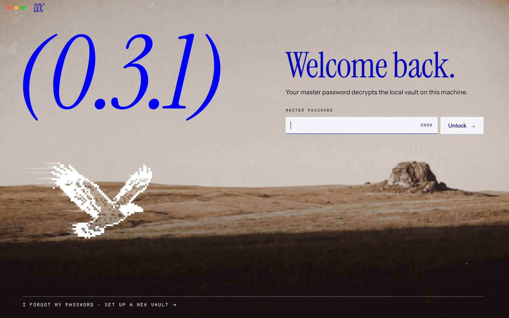
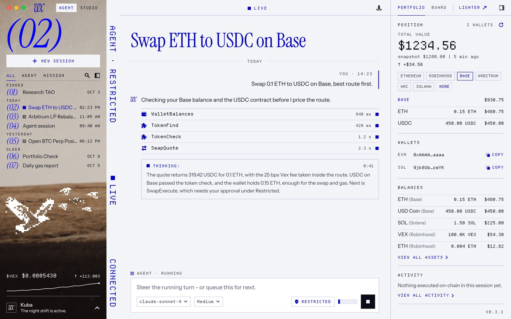
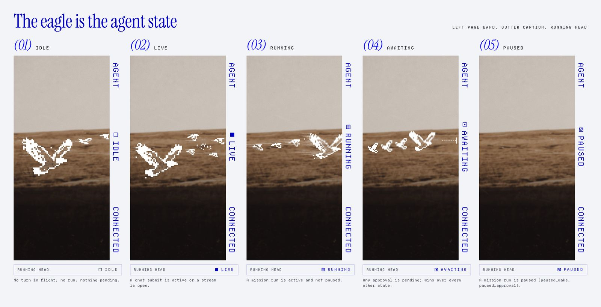

# V10 Spread: the desktop design

The VEX desktop window is an open book. The left page is a 300px window onto the same sepia print the unlock stage shows; the right page (gutter, centre, BOOK) is the working surface. The unlock stage hands off to the welcome spread by sliding the right page in as one leaf while the print and the eagle stay put. The eagle is the agent state: its pose, trails and the running head swatch say Idle, Live, Running, Awaiting or Paused without a word.

## Rules
- One blue (`#0000C0`; `#A3ABFF` as its night-paper form). No second accent.
- Radius 0. No shadow, blur or gradient ramp.
- Status is shown by fill (outline, solid, dot screen, target, hatch), not by colour.
- Warmth lives only inside the print. UI paper and ink stay cool.
- Red and green appear only on candles and their volume.

Every value in this document is the source of truth for the renderer. Code comments cite it as `docs/design/V10-SPREAD.md section N`.

## Reference screens
Light (Celeris) and dark (Chronos), 1440 x 900:

| Screen | Light | Dark |
|---|---|---|
| d1 unlock | [light](img/light-d1-unlock.jpg) | [dark](img/dark-d1-unlock.jpg) |
| d2 welcome | [light](img/light-d2-welcome.jpg) | [dark](img/dark-d2-welcome.jpg) |
| d3 session | [light](img/light-d3-session.jpg) | [dark](img/dark-d3-session.jpg) |
| d4 approval | [light](img/light-d4-approval.jpg) | [dark](img/dark-d4-approval.jpg) |
| d5 lighter | [light](img/light-d5-lighter.jpg) | [dark](img/dark-d5-lighter.jpg) |
| d6 studio | [light](img/light-d6-studio.jpg) | [dark](img/dark-d6-studio.jpg) |
| d7 settings | [light](img/light-d7-settings.jpg) | [dark](img/dark-d7-settings.jpg) |
| d8 wizard | [light](img/light-d8-wizard.jpg) | [dark](img/dark-d8-wizard.jpg) |

Agent states: [light-states](img/light-states.jpg). Handoff frames: [t1](img/light-t1.jpg), [t2](img/light-t2.jpg), [t3](img/light-t3.jpg).

## 1. Tokens
**Colour, light (Celeris).** `--paper #F3F4F7`, `--paper-2 #E8EAF2`, `--ink #0A0D18`, `--ink-2 #3A3E52`, `--muted #565C78`, `--blue #0000C0`, `--blue-hi #0000FF` (counters and numerals only), `--focus #0000FF`, `--app-field #FFFFFF` (fields, composer), `--label-box #F3F4F7` (boxes on the print), `--on-photo #FFFFFF`, `--rule rgba(0,0,192,.22)`, `--app-rule-quiet rgba(0,0,192,.12)`, `--rule-photo rgba(255,255,255,.42)`, `--sky-rule rgba(10,13,24,.18)`, `--rule-ink #0A0D18`.
**Colour, dark (Chronos, Night Ledger).** `--night #1B1412` (paper), `--night-0 #150F0D`, `--night-1 #221A17` (fields), `--night-2 #2A201C`, `--type #F3F4F7`, `--type-2 #BBBABB`, `--type-3 #989697`, `--peri #A3ABFF` (blue on night paper), `--peri-hi #6470FF`, `--true-blue #0000C0` (fills only), `--rule rgba(243,244,247,.14)`, `--app-rule-quiet rgba(243,244,247,.07)`, `--sky-rule rgba(243,244,247,.32)`. On the night print every type is `--type`; blue never sits on dark ground.
**Exceptions.** Candles and their volume `#22C55E` and `#EF4444`, inside `.lchart` only. Traffic lights `#FF5F57 #FEBC2E #28C840`, OS chrome.
**Type.** Instrument Serif italic counters: stage `288px`, left page `112px`, index and step numerals `24px` (line 26). Serif roman: unlock `100px`, welcome `96px`, chapter, overlay and wizard titles `56px` (`48px` under 1276), arena and chat rail `36px`. Never under 24 (numerals) or 32 (words). Instrument Sans: `18px` stage lead, `15.5px/1.62` agent text, `15px` setting titles, `14px` rows, `13px` help. Departure Mono 400 only: `33px` figures, `22px` gutter caption, `13px` tool names, `12px` data, `11px` labels (`--tr-eyebrow .18em`, `--tr-status .14em`, `--tr-chip .12em`, tape word `.24em`), `10px` group heads. JetBrains Mono `11.5px/17.5px` in terminals only.
**Spacing.** 8px base (`--sp-1 8px` to `--sp-6 48px`). App geometry: `--rh 44px`, `--lp 300px`, `--gut 36px`, `--gut-sm 22px`, `--book 340px`, `--spine 56px`, `--leaf 600px`, `--overlay-w 138px`. Centre padding 32 (24 under 1276), BOOK padding 20 (16 under 1316).
**Rules.** `1px --rule` between regions and under every 44px head; `--app-rule-quiet` inside a block; `--frame 1.5px` for REAL FUNDS, the selected tile and the risk callout; hatch `45deg 1px / 4px` (8px band on the ApprovalCard, 10px on the callout); dotted ink rule above the index fold. Radius 0, no shadow, blur or gradient ramp.

## 2. Columns and breakpoints (centre never under the app's 640)
| Window | Left | Gutter | Centre | BOOK | At |
|---|---|---|---|---|---|
| 1316 and up | page 300 | 36 | 1fr | 340 | 1440: 764 |
| 1276 to 1315 | page 300 | 36 | 1fr | 300 | 1280: 644, 1276: 640 |
| under 1276 | spine 56 | 0 (folds into the running head) | 1fr | 300 | 1000: 644 |
| Lighter | spine 56 | 22 | desk 1fr, chat rail 400 | none | 1440: desk 962 |
| Studio | spine 56 | 22 | rail 240, workspace 1fr | 300 | 1440: 822 |
| Overlay (d7) | page 300 | 36 | one sheet, body max 760 | none | |
| Stage (d1, d8) | full window print | | paper leaf 600 at the right (d8) | | |

## 3. The left page
The print is in place: `.lp__print` is the stage print at window size (`100vw x 100vh`, cover, `60% 50%`), so the page is a 300px window onto the same picture the stage showed.
- **Page (1276 and up).** Head row 44 (drag): traffic lights, vx mark 30 x 24 at x 96, Agent | Studio (24px, the pressed one in a label box). Sky, from 44 to `--horizon 57.2vh` less 14: counter 112 with an 11px cap, New session 36 (label box), tabs 30 (All, Agent, Mission, search, collapse), the session index, the fold. Band: the flock canvas. Ground: $VEX 15px mono with a 26px spark, `--rule-photo`, profile row 64.
- **Index scroll.** Only the index scrolls; counter, New session and tabs stay. Rows are 26, group heads 17. A row the horizon would cut is not drawn; the fold (22px, dotted ink rule, `n more ↓`) counts the rows below and scrolls one page. The open session is scrolled into view. 1440 x 900 holds all 7 rows; 1280 x 800 holds 5 and shows `2 more`.
- **Spine (under 1276, and always in Lighter and Studio).** A paper cap 44 under the head row, then the print: New session 32 x 32 in a label box, 24px numerals at 27px pitch with a 2px blue-hi bar on the current one, separators 22 wide, the eagle alone in the band (42 wide, cell 2), avatar 28 at the foot.

## 4. The running head (the status strip)
44px, grid `1fr auto 1fr`, padding `0 16 0 32`, a drag region with no-drag controls. Centre: the tape word (11px mono, `.24em`, 9px swatch; blue, Idle in `--ink-2`). Right: `AWAITING n` (28px, blue outline, target swatch) and export 32; Studio puts the host pill here; an overlay puts its title left and close right. Under 1276 the left cell carries the gutter text (`.rh__fold`). Empty on welcome (rule transparent).

## 5. The gutter caption
36px column, `writing-mode: vertical-rl`, Departure Mono 22px, `--tr-caption .06em`, uppercase, blue, padding 72 top 32 bottom, three groups spread: context, state (12px swatch), connection. Lighter and Studio: 22px column at 11px, `.18em`. It is `aria-hidden` and only repeats: context = mode toggle, permission seat and BOOK Session block; state = the tape word; connection = the profile line. Under 1276 it folds into the running head.

## 6. Eagle and flock: the agent state
Trigger = the tape state precedence: awaiting, then live, then paused, then running, else idle (Sleeping draws idle). The turn island words (Working, Thinking, Calling, Running, Writing) all sit inside Live.
| State | Trigger | Flock | Fill |
|---|---|---|---|
| Idle | no submit, no run, nothing pending | eagle gliding (150 wide, cell 4, trail .42 x 12), two far birds resting | outline |
| Live | chat submit active or stream open | eagle short trails (.26 x 6), four far birds wheeling round a point, 26 dust pixels gathering | solid |
| Running | a mission run active | single file with full trails (.62 x 22, far birds .7 x 16), eagle leading (104 wide) | dot screen |
| Awaiting | any pending approval | frozen, crisp, no trails, no bob, dotted hold line 40 with a stop bar ahead of the lead | target |
| Paused | run status `paused_*` | the empty print | hatch |
White `#FFFFFF` blocks, 4 x 4 Bayer dither, trails reseeded every 200ms (`--frame-step`), 30fps cap, paused off screen and in a hidden window. The eagle is placed by its alpha bounds (centre and visible width), so stage and page poses line up.

## 7. Safety (unchanged behaviour)
ApprovalCard: `--frame` ink frame, 8px hatch band, reversed `Real funds` stamp, risk tags; Reject has first focus (2px `--focus` ring, offset 3); a high-risk Approve needs the second click "Click again to confirm approve"; the rest of the session sits under a 2px paper dither veil.

## 8. Title bar per OS
`titleBarStyle: 'hidden'` everywhere; every 44px head row is the drag region. macOS: `trafficLightPosition {x: 20, y: 16}`, the lights sit on the print. Windows and Linux (`html[data-os='win']`): `titleBarOverlay {height: 43, color: --paper, symbolColor: --ink}` (the 44px row less its rule, so each head's rule runs on under the buttons to the window edge), recoloured with `setTitleBarOverlay` on a theme change; the lights' 96px inset drops to 18, and the BOOK head, overlay head, Lighter bar and wizard leaf reserve `--overlay-w 138px` plus 8. The BOOK head is a size container: when the words Portfolio, Board and Lighter no longer fit beside the collapse key and that reserve, the three become pixel icons, each keeping its word as its name and tooltip.

## 9. Art that ships
| File | Size | Bytes |
|---|---|---|
| `art/plateau.jpg` (day print) | 2560 x 1440 | 150,801 |
| `art/plateau-night.jpg` (the day print graded to night in code, 0 generations) | 2560 x 1440 | 102,175 |
| `art/eagle.png` (Desktop eagle sprite) | 480 x 369 | 77,840 |
| `art/birds/bird-{1,3,6,7,8}.webp` (far birds) | 192 wide | 41,530 |
| `art/fonts/jetbrains-mono-latin-wght.woff2` (terminals) | | 40,404 |
Plus the Instrument Serif, Instrument Sans and Departure Mono woff2 files. Art total 372 KB.

## 10. The handoff and reduced motion
Unlock to welcome: the print and the eagle stay; the right page (gutter, centre, BOOK) arrives as one leaf on `left`, from the window edge to `--lp`, over `--dur-4 480ms` `--ease-out`; the stage type fades over `--dur-3 240ms`; the eagle eases from its stage pose (288 wide at 288, 567) to its page pose (150 wide at 99, 596) and the page furniture fades in once the leaf passes 760. Frames: `t1` Unlocking, leaf at 1384; `t2` leaf at 760, stage type at 25%; `t3` leaf at 360, the page forming at 60%; the end state is `d2`.
**Reduced motion.** Each plate paints one still frame, identical to the renders; swatches do not step; the leaf is placed at `--lp` and the stage and the welcome spread crossfade over a fixed `240ms linear` (the duration tokens are zeroed under reduced motion, so the value is literal). Nothing slides.
